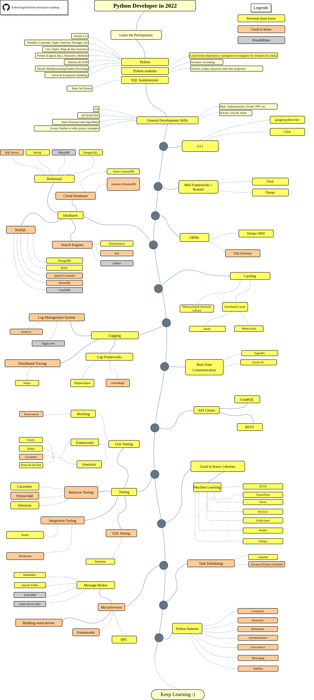

# Python Developer Roadmap

> Roadmap to becoming a [Python](https://www.python.org/) developer in 2022-2023:
Below you can find a chart demonstrating the paths that you can take and the libraries that you would want to learn to become a Python developer. I made this chart as a tip for everyone who asks me, "*What should I learn next as a Python developer?*"

## 2026 Implementation

- Detailed execution plan: [docs/backend-roadmap-2026.md](docs/backend-roadmap-2026.md)
- Starter backend scaffold: [starter-backend/README.md](starter-backend/README.md)

This implementation package adds:

- A cleaned and modernized backend roadmap with Must Know, Good to Know, and Optional scope
- A 12 week progression plan with practical deliverables
- A runnable starter backend project with FastAPI, tests, Docker, and quality checks

## Disclaimer

> The purpose of this roadmap is to give you an idea about the landscape. The road map will guide you if you are confused about what to learn next, rather than encouraging you to pick what is hype and trendy. You should grow some understanding of why one tool would be better suited for some cases than the other and remember hype and trendy does not always mean best suited for the job.

## Give a Star! :star:

If you like or are using this project to learn or start your solution, please give it a star. Thanks!

## Roadmap

## TODO:
* Add Microservices
* Good to Know Libraries
* Add API Clients
* Add extra subtree for data process and data manipulation 

## Resources

1. Prerequisites

   - [Python](https://docs.python.org/3/tutorial/index.html)
   - [Python Modules](https://docs.python.org/3/tutorial/modules.html)
   - [SQL](https://www.w3schools.com/sql/default.asp)

2. General Development Skills

   - Learn GIT, create a few repositories on GitHub, share your code with other people
   - Know HTTP(S) protocol, request methods (GET, POST, PUT, PATCH, DELETE, OPTIONS)
   - Don't be afraid of using Google, [Power Searching with Google](http://www.powersearchingwithgoogle.com/)
   - Read a few books about algorithms and data structures
   - Learn about implementation of a basic Authentication
   - Solid principles, architectural & design patterns, ecc
   - Basics of software testing (unit, integration, e2e)

3. CLI Tools
   1. [google/python-fire](https://github.com/google/python-fire)
   2. [click](https://click.palletsprojects.com/en/8.0.x/)

4. Web Frameworks + Routers

   1. [Flask](https://flask.palletsprojects.com/en/2.0.x/)
   2. [Django](https://www.djangoproject.com/)

5. Databases

   1. Relational
      1. [SQL Server](https://www.microsoft.com/en-us/sql-server/sql-server-2017)
      2. [PostgreSQL](https://www.postgresql.org/)
      3. [MariaDB](https://mariadb.org/)
      4. [MySQL](https://www.mysql.com/)
     
   2. Cloud Databases
      - [CosmosDB](https://docs.microsoft.com/en-us/azure/cosmos-db)
      - [DynamoDB](https://aws.amazon.com/dynamodb/)
   3. Search Engines
      - [ElasticSearch](https://www.elastic.co/)
      - [Solr](http://lucene.apache.org/solr/)
      - [Sphinx](http://sphinxsearch.com/)
   4. NoSQL
      - [MongoDB](https://www.mongodb.com/)
      - [Redis](https://redis.io/)
      - [Apache Cassandra](http://cassandra.apache.org/)
      - [RavenDB](https://github.com/ravendb/ravendb)
      - [CouchDB](http://couchdb.apache.org/)

6. ORMs

   1. [Django ORM](https://docs.djangoproject.com/en/3.2/topics/db/queries/)
   2. [SQLAlchemy](https://www.sqlalchemy.org/)
   3. [Extra](https://www.fullstackpython.com/object-relational-mappers-orms.html)
7. Caching

   1. [Memcached](https://pypi.org/project/python-memcached/)
   2. Distributed Cache
      1. [Redis](https://github.com/redis/redis-py)
      2. [Memcached](https://pypi.org/project/python-memcached/)

8. Logging

   1. Log Frameworks
      - [Delgan/loguru](https://github.com/Delgan/loguru)
      - [Coloredlogs](https://github.com/xolox/python-coloredlogs)
      -
   2. Log Management System
      - [Sentry.io](http://sentry.io)
      - [Loggly.com](https://loggly.com)
   3. Distributed Tracing
      - [Jaeger](https://www.jaegertracing.io/)

9. Real-Time Communication
   1. [SignalPy](https://pypi.org/project/SignalPy/)
   2. [Socket.IO](https://python-socketio.readthedocs.io/en/latest/)

10. API Clients

    1. REST

    2. [GraphQL](https://graphql.org/)

11. Good to Know

   1. Machine Learning
      1. [NLTK](https://www.nltk.org/)
      2. [TensorFlow](https://www.tensorflow.org/)
      3. [Keras](https://keras.io/)
      4. [PyTorch](https://pytorch.org/)
      5. [Scikit-Learn](https://scikit-learn.org/)
      6. [Pandas](https://pandas.pydata.org/)
      7. [Numpy](https://numpy.org/)

12. Testing

    1. Unit, Behavior, Integration Testing
       1. [Pytest-mock](https://pypi.org/project/pytest-mock/)
       2. [Testify](https://github.com/stretchr/testify)
       3. [Robot](https://robotframework.org/#/)
       4. [Pytest](https://docs.pytest.org/en/6.2.x/)
       5. [Doctest](https://docs.python.org/3/library/doctest.html)
       6. [Pytest-bdd](https://docs.pytest.org/en/6.2.x/)
       7. [Cucumber](https://cucumber.io/docs/installation/python/)
       8. [Dockertest](https://github.com/ory/dockertest)
    2. E2E Testing
       - [Selenium](https://github.com/tebeka/selenium)
       - [Endly](https://github.com/viant/endly)

13. Task Scheduling

    - [scedule](https://schedule.readthedocs.io/en/stable/)
    - [Advanced Python Scheduler](https://apscheduler.readthedocs.io/en/3.x/)
    
14. MicroServices

    1. Message-Broker
       - [RabbitMQ](https://www.rabbitmq.com/tutorials/tutorial-one-go.html)
       - [Apache Kafka](https://kafka.apache.org/)
       - [ActiveMQ](https://github.com/apache/activemq)
       - [Azure Service Bus](https://docs.microsoft.com/en-us/azure/service-bus-messaging/service-bus-messaging-overview)
    2. Building message-driven
       -
    3. Frameworks

    4. RPC
         
15. [Python-Patterns](https://refactoring.guru/design-patterns)

## Wrap Up

If you think the roadmap can be improved, please do open a PR with any updates and submit any issues. Also, I will continue to improve this, so you might want to star this repository to revisit.

Idea from : [Go developer roadmap](https://github.com/Alikhll/golang-developer-roadmap)

## Contribution

The roadmap is built using [Draw.io](https://www.draw.io/). Project file can be found at `python-developer-roadmap.xml` file. To modify it, open draw.io, click **Open Existing Diagram** and choose `xml` file with project. It will open the roadmap for you. Update it, upload and update the images in readme and create a PR (export as png with 400% zoom and minify that with [Compressor.io](https://compressor.io/compress)).

- Open a pull request with improvements
- Discuss ideas in issues
- Spread the word

## 🌐 Web Resources & Aesthetic Symbols Index
- [SYM 2627](https://coquette-aesthetic-symbols-71.pages.dev/symbol/sym-2627/)
- [FOUR POINT STAR SPARKLE](https://minimal-star-symbols-32.pages.dev/symbol/four-point-star-sparkle/)
- [SYM 260C](https://scholarly-vintage-symbols-48.pages.dev/symbol/sym-260c/)
- [FREEFIRE NAMES](https://neon-glitch-fonts-20.pages.dev/pt/freefire-names/)
- [SYM 26E1](https://chibi-emoticon-lab-65.pages.dev/symbol/sym-26e1/)
- [SYM 2616](https://coquette-aesthetic-symbols-84.pages.dev/symbol/sym-2616/)
- [SYM 2621](https://gothic-bio-fonts-86.pages.dev/symbol/sym-2621/)
- [SYM 1D41F](https://coquette-aesthetic-symbols-84.pages.dev/symbol/sym-1d41f/)
- [SYM 26D6](https://coquette-aesthetic-symbols-84.pages.dev/symbol/sym-26d6/)
- [SYM 2664](https://coquette-aesthetic-symbols-14.pages.dev/symbol/sym-2664/)
- [SYM 1D403](https://anime-sparkle-text-22.pages.dev/symbol/sym-1d403/)
- [SYM 1D486](https://chibi-emoticon-lab-65.pages.dev/symbol/sym-1d486/)
- [SYM 1F634](https://coquette-aesthetic-symbols-84.pages.dev/symbol/sym-1f634/)
- [AQUARIUS ZODIAC WATER BEARER](https://scholarly-vintage-symbols-48.pages.dev/symbol/aquarius-zodiac-water-bearer/)
- [SYM 1D41A](https://gothic-bio-fonts-86.pages.dev/symbol/sym-1d41a/)
- [SYM 1F633](https://chibi-emoticon-lab-65.pages.dev/symbol/sym-1f633/)
- [KAOMOJI](https://chibi-emoticon-lab-65.pages.dev/es/kaomoji/)
- [SYM 1F92D](https://vintage-scholar-text-15.pages.dev/symbol/sym-1f92d/)
- [TWELVE POINTED STAR](https://matrix-glitch-text-37.pages.dev/symbol/twelve-pointed-star/)
- [GREEK PSI TRIDENT](https://ribbon-heart-fonts-86.pages.dev/symbol/greek-psi-trident/)
- [HEARTS](https://occult-aesthetic-symbols-26.pages.dev/ru/hearts/)
- [ARIES ZODIAC RAM](https://dolly-kaomoji-text-94.pages.dev/symbol/aries-zodiac-ram/)
- [SYM 1F60E](https://vintage-scholar-text-15.pages.dev/symbol/sym-1f60e/)
- [SYM 2614](https://vintage-scholar-text-15.pages.dev/symbol/sym-2614/)
- [SYM 268B](https://gothic-bio-fonts-86.pages.dev/symbol/sym-268b/)
- [SYM 1F600](https://ribbon-heart-fonts-86.pages.dev/symbol/sym-1f600/)
- [SYM 1F634](https://pastel-manga-symbols-57.pages.dev/symbol/sym-1f634/)
- [SYM 2679](https://anime-sparkle-text-73.pages.dev/symbol/sym-2679/)
- [SYM 2645](https://coquette-aesthetic-symbols-14.pages.dev/symbol/sym-2645/)
- [SYM 26FE](https://coquette-aesthetic-symbols-84.pages.dev/symbol/sym-26fe/)
- [SYM 2639](https://anime-sparkle-text-22.pages.dev/symbol/sym-2639/)
- [FREEFIRE NAMES](https://vintage-angel-symbols-66.pages.dev/ru/freefire-names/)
- [SYM 1FAE2](https://scholarly-vintage-symbols-48.pages.dev/symbol/sym-1fae2/)
- [ARIES ZODIAC RAM](https://pastel-manga-symbols-57.pages.dev/symbol/aries-zodiac-ram/)
- [SYM 267C](https://vintage-scholar-text-15.pages.dev/symbol/sym-267c/)
- [SYM 1F62C](https://witchy-runic-text-71.pages.dev/symbol/sym-1f62c/)
- [LITTLE CAT PAWS KAOMOJI](https://ribbon-heart-fonts-86.pages.dev/symbol/little-cat-paws-kaomoji/)
- [SYM 274B](https://gothic-bio-fonts-86.pages.dev/symbol/sym-274b/)
- [SYM 26E4](https://minimal-star-symbols-25.pages.dev/symbol/sym-26e4/)
- [SYM 26B0](https://baroque-font-vault-96.pages.dev/symbol/sym-26b0/)
- [SYM 1F917](https://futuristic-gaming-fonts-52.pages.dev/symbol/sym-1f917/)
- [SYM 1D41F](https://gothic-bio-fonts-86.pages.dev/symbol/sym-1d41f/)
- [SYM 1D451](https://chibi-emoticon-lab-65.pages.dev/symbol/sym-1d451/)
- [MUSIC WEATHER](https://witchy-runic-text-71.pages.dev/ru/music-weather/)
- [SYM 1F625](https://pastel-manga-symbols-57.pages.dev/symbol/sym-1f625/)
- [INSTAGRAM BIO](https://chibi-emoticon-lab-65.pages.dev/instagram-bio/)
- [SYM 1D48D](https://anime-sparkle-text-73.pages.dev/symbol/sym-1d48d/)
- [SYM 26CB](https://vintage-angel-symbols-66.pages.dev/symbol/sym-26cb/)
- [SYM 26CD](https://anime-sparkle-text-22.pages.dev/symbol/sym-26cd/)
- [SYM 26A9](https://pastel-manga-symbols-57.pages.dev/symbol/sym-26a9/)
- [SYM 1D45F](https://futuristic-gaming-fonts-52.pages.dev/symbol/sym-1d45f/)
- [SYM 2741](https://vintage-angel-symbols-66.pages.dev/symbol/sym-2741/)
- [JA](https://anime-sparkle-text-22.pages.dev/ja/)
- [HEAVY HEART EXCLAMATION](https://pastel-manga-symbols-57.pages.dev/symbol/heavy-heart-exclamation/)
- [WINGED ANGELIC COQUETTE HEART](https://vintage-angel-symbols-66.pages.dev/symbol/winged-angelic-coquette-heart/)
- [SYM 1D455](https://coquette-aesthetic-symbols-84.pages.dev/symbol/sym-1d455/)
- [DISCORD STATUS](https://vintage-angel-symbols-66.pages.dev/vi/discord-status/)
- [ROBLOX NAMES](https://futuristic-gaming-fonts-52.pages.dev/vi/roblox-names/)
- [SYM 1F62D](https://ribbon-heart-fonts-86.pages.dev/symbol/sym-1f62d/)
- [SYM 267D](https://matrix-glitch-text-37.pages.dev/symbol/sym-267d/)
- [SYM 1D43F](https://matrix-glitch-text-37.pages.dev/symbol/sym-1d43f/)
- [SYM 1D477](https://vintage-scholar-text-15.pages.dev/symbol/sym-1d477/)
- [SYM 26AA](https://anime-sparkle-text-22.pages.dev/symbol/sym-26aa/)
- [SYM 1D448](https://vintage-scholar-text-15.pages.dev/symbol/sym-1d448/)
- [SYM 1F633](https://vintage-angel-symbols-66.pages.dev/symbol/sym-1f633/)
- [HIGH VOLTAGE LIGHTNING](https://ribbon-heart-fonts-86.pages.dev/symbol/high-voltage-lightning/)
- [SYM 1D405](https://pastel-chibi-emotes-23.pages.dev/symbol/sym-1d405/)
- [SYM 1D46F](https://occult-aesthetic-symbols-26.pages.dev/symbol/sym-1d46f/)
- [SYM 1D488](https://coquette-aesthetic-symbols-14.pages.dev/symbol/sym-1d488/)
- [SYM 1F974](https://vintage-angel-symbols-66.pages.dev/symbol/sym-1f974/)
- [SYM 26F8](https://coquette-aesthetic-symbols-84.pages.dev/symbol/sym-26f8/)
- [SYM 1F620](https://coquette-aesthetic-symbols-84.pages.dev/symbol/sym-1f620/)
- [SYM 1F92A](https://vintage-angel-symbols-66.pages.dev/symbol/sym-1f92a/)
- [SYM 1FA75](https://baroque-font-vault-96.pages.dev/symbol/sym-1fa75/)
- [SYM 265C](https://matrix-glitch-text-37.pages.dev/symbol/sym-265c/)
- [SYM 1D40C](https://scholarly-cross-symbols-35.pages.dev/symbol/sym-1d40c/)
- [SYM 1D42C](https://occult-aesthetic-symbols-26.pages.dev/symbol/sym-1d42c/)
- [SYM 1F972](https://futuristic-gaming-fonts-52.pages.dev/symbol/sym-1f972/)
- [SYM 1D452](https://coquette-aesthetic-symbols-14.pages.dev/symbol/sym-1d452/)
- [DISCORD STATUS](https://futuristic-gaming-fonts-52.pages.dev/vi/discord-status/)
- [TRENDING](https://baroque-font-vault-96.pages.dev/pt/trending/)
- [ROBLOX NAMES](https://chibi-emoticon-lab-65.pages.dev/es/roblox-names/)
- [SYM 1F636 200D 1F32B FE0F](https://witchy-runic-text-71.pages.dev/symbol/sym-1f636-200d-1f32b-fe0f/)
- [SYM 26F5](https://coquette-aesthetic-symbols-84.pages.dev/symbol/sym-26f5/)
- [SYM 1F619](https://coquette-aesthetic-symbols-84.pages.dev/symbol/sym-1f619/)
- [SYM 1D40B](https://occult-aesthetic-symbols-26.pages.dev/symbol/sym-1d40b/)
- [SYM 1F61F](https://scholarly-vintage-symbols-48.pages.dev/symbol/sym-1f61f/)
- [SYM 26FA](https://gothic-bio-fonts-86.pages.dev/symbol/sym-26fa/)
- [SYM 2625](https://anime-sparkle-text-73.pages.dev/symbol/sym-2625/)
- [SHADOWED WHITE STAR](https://futuristic-gaming-fonts-52.pages.dev/symbol/shadowed-white-star/)
- [GAMING WEAPONS](https://chibi-emoticon-lab-65.pages.dev/pt/gaming-weapons/)
- [ARROWS LINES](https://witchy-runic-text-71.pages.dev/pt/arrows-lines/)
- [ZODIAC CELESTIAL](https://baroque-font-vault-96.pages.dev/vi/zodiac-celestial/)
- [SYM 1F612](https://futuristic-gaming-fonts-52.pages.dev/symbol/sym-1f612/)
- [ROBLOX NAMES](https://baroque-font-vault-96.pages.dev/ja/roblox-names/)
- [SYM 1F603](https://kawaii-kaomoji-hub-80.pages.dev/symbol/sym-1f603/)
- [SAGITTARIUS ZODIAC ARCHER](https://witchy-runic-text-71.pages.dev/symbol/sagittarius-zodiac-archer/)
- [SYM 1D404](https://baroque-font-vault-96.pages.dev/symbol/sym-1d404/)
- [SYM 1D40D](https://occult-aesthetic-symbols-26.pages.dev/symbol/sym-1d40d/)
- [SYM 1D44D](https://vintage-angel-text-38.pages.dev/symbol/sym-1d44d/)
- [SYM 1D48C](https://anime-sparkle-text-73.pages.dev/symbol/sym-1d48c/)
- [ROBLOX NAMES](https://zen-aesthetic-fonts-87.pages.dev/vi/roblox-names/)
- [SYM 26C3](https://dark-poetry-fonts-30.pages.dev/symbol/sym-26c3/)
- [SYM 2645](https://gothic-bio-fonts-61.pages.dev/symbol/sym-2645/)
- [SYM 26EC](https://clean-mono-fonts-64.pages.dev/symbol/sym-26ec/)
- [BRACKETS](https://zen-aesthetic-fonts-87.pages.dev/pt/brackets/)
- [SYM 2613](https://ribbon-bow-unicode-18.pages.dev/symbol/sym-2613/)
- [BLACK HEART](https://minimal-star-symbols-26.pages.dev/symbol/black-heart/)
- [SYM 1F61F](https://pastel-moe-emoticons-55.pages.dev/symbol/sym-1f61f/)
- [SYM 1D449](https://neon-hacker-text-25.pages.dev/symbol/sym-1d449/)
- [SYM 1D420](https://cyber-clan-tags-36.pages.dev/symbol/sym-1d420/)
- [SYM 1D496](https://techno-hacker-text-43.pages.dev/symbol/sym-1d496/)
- [SYM 2636](https://clean-mono-fonts-64.pages.dev/symbol/sym-2636/)
- [SYM 1D442](https://gothic-bio-fonts-86.pages.dev/symbol/sym-1d442/)
- [BORDERS DIVIDERS](https://minimal-star-symbols-26.pages.dev/vi/borders-dividers/)
- [SYM 1D46B](https://scholarly-cross-symbols-35.pages.dev/symbol/sym-1d46b/)
- [SYM 262E](https://gothic-bio-fonts-86.pages.dev/symbol/sym-262e/)
- [FREEFIRE NAMES](https://techwear-bio-symbols-45.pages.dev/freefire-names/)
- [SYM 1D424](https://occult-aesthetic-symbols-26.pages.dev/symbol/sym-1d424/)
- [SYM 26B2](https://pastel-manga-symbols-57.pages.dev/symbol/sym-26b2/)
- [SYM 1D459](https://pearl-heart-symbols-95.pages.dev/symbol/sym-1d459/)
- [SYM 1F927](https://minimal-star-symbols-26.pages.dev/symbol/sym-1f927/)
- [SYM 1D443](https://glitch-matrix-fonts-28.pages.dev/symbol/sym-1d443/)
- [SYM 1D492](https://neon-hacker-text-25.pages.dev/symbol/sym-1d492/)
- [SYM 1D426](https://gothic-bio-fonts-86.pages.dev/symbol/sym-1d426/)
- [SYM 26D1](https://chibi-emoticon-lab-65.pages.dev/symbol/sym-26d1/)
- [SYM 2644](https://scholarly-runes-text-68.pages.dev/symbol/sym-2644/)
- [SYM 1F62D](https://sleek-line-unicode-29.pages.dev/symbol/sym-1f62d/)
- [SYM 1D494](https://matrix-glitch-text-37.pages.dev/symbol/sym-1d494/)
- [SYM 2747](https://zen-spacing-text-68.pages.dev/symbol/sym-2747/)
